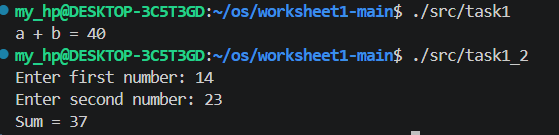
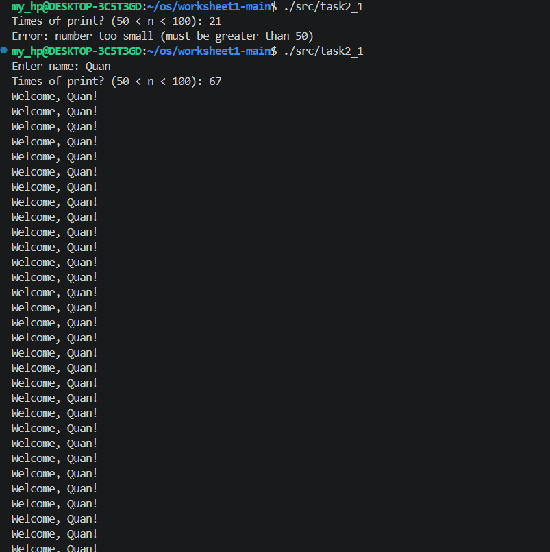
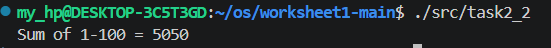
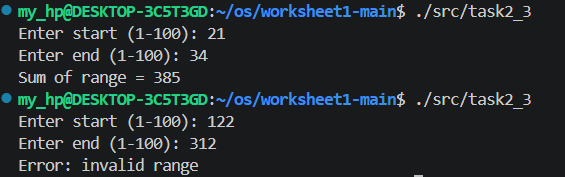
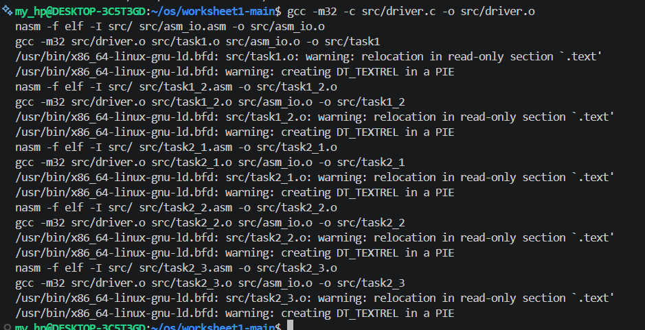

# UFCFWK-15-2 Worksheet 1

Build everything with `make` in the repo root, clean with `make clean`.
Programs are 32-bit NASM assembly called from a small C driver (`src/driver.c`), which provides `main` and calls `asm_main`. This needs `nasm` and 32-bit gcc support (`sudo apt install gcc-multilib`).


## Task 1

### task1.asm
Adds two integers stored in global memory and prints the result with `print_int`.

```nasm
mov  eax, [a]      ; [a] reads the VALUE stored at label a

add  eax, [b]

mov  ebx, eax      ; keep the sum, print_string overwrites eax

mov  eax, msg      ; no brackets: the ADDRESS of the string

call print_string

mov  eax, ebx

call print_int
```



### task1_2.asm
Reads two integers with `read_int` (result returned in `eax`), stores them in `.bss`, adds them and prints the sum. The values are unknown until run time, so they are reserved:

```nasm
segment .bss
input1  resd 1          ; reserve one dword (4 bytes)
input2  resd 1

call read_int           ; number typed comes back in eax
mov  [input1], eax
```


## Task 2

### task2_1.asm: name and welcome loop
The name is read with `read_char` until newline (10) and stored as a 0-terminated string. The count is checked with `cmp` and conditional jumps, then `loop` repeats the welcome message `ecx` times.

```nasm
cmp  eax, 50

jle  too_small      ; n <= 50 is an error

cmp  eax, 100

jge  too_big        ; n >= 100 is an error

mov  ecx, [count]

print_loop:
...
loop print_loop     ; ecx--, jump back while ecx != 0
```

The name is read before `read_int`, because `read_int` uses `scanf("%d")`, which leaves the newline in the input buffer.

Valid input (67), invalid input (21):



### task2_2.asm: sum of array 1..100
The array has 100 dwords in `.bss`. Element `i` is at `[array + esi*4]` because each element is 4 bytes. `ecx` is the `loop` counter and `esi` is the index, because `loop` changes `ecx` itself.

```nasm

lea  eax, [esi+1]           ; value = index + 1

mov  [array + esi*4], eax

inc  esi

loop fill

mov  ecx, 100                       ; reset counter and index for the sum
```

The result is 1 + 2 + ... + 100 = 5050.



### task2_3.asm: sum of a range
Same array, the user enters start and end. The range is valid only if `1 <= start <= end <= 100`. The array index is `start-1` because the array is 0-based, and the number of elements is `end - start + 1` because both ends are included.

```nasm
cmp  ebx, 1
jl   bad            ; start < 1
cmp  esi, 100
jg   bad            ; end > 100
cmp  ebx, esi
jg   bad            ; start > end

mov  ecx, esi
sub  ecx, ebx
inc  ecx            ; count = end - start + 1
lea  edi, [ebx-1]   ; 0-based index of start
```

Validation runs first, so `ecx` is at least 1 when the loop starts (a `loop` with `ecx = 0` would wrap round and repeat about 4 billion times).



## Task 3: Makefile

The `all` target builds `task1`, `task1_2`, `task2_1`, `task2_2` and `task2_3`. Pattern rules assemble each `.asm` with `nasm -f elf` and link with `gcc -m32` together with `driver.o` and `asm_io.o`.

```makefile
$(TARGETS): $(SRC)/%: $(SRC)/%.o $(COMMON)
	$(CC) $(CFLAGS) $(SRC)/driver.o $< $(SRC)/asm_io.o -o $@

$(SRC)/%.o: $(SRC)/%.asm $(SRC)/asm_io.inc
	$(NASM) $(NASMFLAGS) $< -o $@
```



## Notes

`asm_io.asm` provides `print_int`, `print_char`, `print_string`, `print_nl`, `read_int` and `read_char`. Values go in and out through `eax`.

Problems I hit along the way:

- **Link errors (`cannot find Scrt1.o`, `crti.o`, `-lgcc`)**: the machine had no 32-bit C runtime. Fixed with `sudo apt install gcc-multilib`.

- **`inc ecx` before `loop`**: `loop` already decrements `ecx`, so the two cancel out and the loop runs once or never ends. The array index needs its own register.

- **Sum of 5049 instead of 5050**: the sum loop indexed the array with the `loop` counter (`[array + ecx*4]`) instead of the index register, so it skipped `array[0]` and read past the end.

- **`cmp` before `loop` does nothing**, because `loop` does not read the flags.
